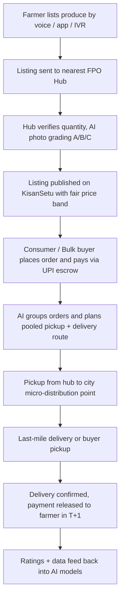

# Smart India Hackathon Workshop
# Date:30-10-26
## Reference Number:2601088
## Name: Rohith Krishna K

## Problem Title
SIH 26033: Multiple intermediaries reduce farmers earnings and increase consumer prices.

## Problem Creater's Organization
Ministry of Consumer Affairs, Food & Public Distribution

## Theme
Agriculture, FoodTech & Rural Development

## Problem Description
Expected Solution: Create a digital marketplace that:

• Connects farmers/FPOs directly with consumers and bulk buyers.
• Provides logistics support.
• Uses AI for demand forecasting and route optimization.

Benefits:

• Better prices for farmers.
• Lower prices for consumers.
• Reduced supply chain inefficiencies.

## Proposed Solution

### Solution Name: **KisanSetu: A Voice-First, FPO-Hub Powered Direct Marketplace**

**1. Detailed explanation of the proposed solution**

KisanSetu is a mobile and voice-first digital marketplace where farmers and Farmer Producer Organizations (FPOs) list produce and sell it directly to households, retailers, restaurants, hostels, and bulk buyers. Instead of trying to put every farmer on a complex app, the platform is built around village-level **Collection and Grading Hubs** run by FPOs or Self Help Groups (SHGs).

The platform has four main parts:

- **Farmer interface (voice + WhatsApp + IVR + app):** A farmer can say "Mere paas 20 quintal tomato hai" in their own language. Speech recognition converts it to a listing. Farmers with feature phones can use a missed-call/IVR flow.
- **Buyer interface (app + web):** Consumers, kirana stores, and bulk buyers browse produce, see the grade and the farm origin, and place orders for single-day delivery or weekly subscriptions.
- **Hub-and-spoke logistics layer:** Produce is collected at the village hub, graded and weighed, then moved by pooled vehicles to city micro-distribution points. No separate trucks per farmer.
- **AI engine:** Forecasts demand and prices, suggests what to sell and when, groups orders, and plans the delivery routes.

**2. How it addresses the problem**

| Problem in the supply chain | How KisanSetu handles it |
|---|---|
| Many layers (commission agent, wholesaler, sub-wholesaler, retailer) take a margin | Orders flow from buyer to FPO hub directly. Only one transparent platform fee (target 3 to 5%) is charged |
| Farmer does not know the right price and gets pushed to sell low | Live "fair price band" built from mandi arrival and price data, shown in the farmer's language |
| High transport cost for small lots | Pooled, route-optimised pickups so many small farmers share one vehicle |
| Spoilage while goods change hands | Fewer handovers, shorter time between harvest and delivery, demand forecast to avoid over-harvesting without a buyer |
| Delayed or uncertain payment | UPI-based escrow: buyer pays at order, money is released to the farmer's bank account as soon as delivery is confirmed (target T+1) |
| Consumer cannot tell quality | Photo-based AI grading at the hub with a grade label (A/B/C) on every lot |

**3. Innovation and uniqueness of the solution**

- **Voice-first, multilingual onboarding** so low-literacy and feature-phone farmers can participate. Most existing platforms assume smartphone literacy.
- **FPO hub as the trust and quality anchor.** The hub is a physical point of verification, which removes the biggest gap of pure-digital marketplaces (quality disputes and last-mile pickup).
- **AI "Sell Now / Hold / Shift Market" advisor** that gives each farmer a simple recommendation based on forecast price, perishability, and nearby demand.
- **Computer-vision grading** from a phone camera at the hub, so grading is quick, consistent, and less open to haggling.
- **Pooled logistics with a vehicle-routing optimiser** that merges pickups and deliveries to reduce empty running.
- **Open network compatibility:** Built to work with ONDC so that KisanSetu listings can also be discovered through other buyer apps.

## Technical Approach

**1. Technologies to be used**

| Layer | Technology |
|---|---|
| Frontend (buyer and farmer app) | Flutter (Android first, light build for low-end phones), React for the web and admin dashboards |
| Voice and language | Speech-to-text and text-to-speech for Indian languages (for example AI4Bharat / Bhashini APIs), Twilio/Exotel-type IVR, WhatsApp Business API |
| Backend | Node.js (NestJS) or Python FastAPI microservices, REST + WebSockets for live order tracking |
| Database | PostgreSQL (with PostGIS for location), Redis for caching, object storage for images |
| AI/ML | Python, scikit-learn, XGBoost/LightGBM and Prophet/LSTM for demand and price forecasting; MobileNet/EfficientNet (TensorFlow Lite) for grading; Google OR-Tools for vehicle routing |
| Data sources | Agmarknet / data.gov.in mandi price data, IMD weather data, satellite-based crop area indicators, platform's own order history |
| Payments | UPI (via a payment aggregator), escrow-style settlement, Aadhaar-linked bank accounts of farmers |
| Maps and routing | OpenStreetMap / Google Maps APIs, GPS tracking in driver app |
| Cloud and DevOps | AWS or Azure (or MeghRaj), Docker, Kubernetes, CI/CD with GitHub Actions |
| Security | OAuth2 / JWT, role-based access, encryption at rest and in transit, consent-based data sharing |

**2. Methodology and process for implementation**

*Flow of an order*



*System architecture (high level)*

```
 Farmer (Voice/IVR/App) ─┐                       ┌─ Demand & Price Forecasting
 FPO Hub App ────────────┼──> API Gateway ─────> ├─ Grading (CV) Service
 Buyer App / Web ────────┤                       ├─ Routing & Pooling Engine
 Driver App ─────────────┘                       ├─ Orders / Payments / Escrow
                                                 └─ Notifications (SMS/WhatsApp)
                                   │
                         PostgreSQL + Redis + Object Store
                                   │
              Agmarknet / IMD / Satellite / ONDC network adapters
```

*Phased implementation plan*

1. **Phase 1 (Months 1 to 2): Discovery and pilot design.** Select one district and 2 to 3 crops (for example tomato, onion, leafy vegetables). Sign up 2 to 3 FPOs.
2. **Phase 2 (Months 3 to 5): MVP build.** Listing, ordering, escrow payment, hub app, simple price band, basic routing.
3. **Phase 3 (Months 6 to 8): AI layer.** Add demand/price forecasting, photo grading, and pooled route optimisation. Train on historical Agmarknet data plus pilot data.
4. **Phase 4 (Months 9 to 12): Scale.** Add more districts, ONDC integration, subscriptions, and bulk-buyer contracts.

*Working prototype (suggested for the hackathon)*

- Farmer listing through a voice or WhatsApp-style chat screen
- Buyer app with produce catalogue, grade tags, and cart
- Admin dashboard showing the price forecast chart and a route map with pooled pickups
- Demo of photo upload returning an A/B/C grade

## Feasibility and Viability

**1. Analysis of the feasibility of the idea**

- **Technical:** All components (speech APIs, forecasting models, OR-Tools routing, UPI payments) are mature and available, so the system can be built with existing tools.
- **Operational:** India already has thousands of FPOs, supported under the Central Sector Scheme for formation and promotion of 10,000 FPOs, and many have storage or collection points. These can be used as hubs.
- **Economic:** Revenue comes from a small platform fee, a delivery fee shared across pooled loads, and a premium subscription for bulk buyers with analytics. Cutting two to three intermediary layers leaves room for the farmer to earn more while the buyer pays less.
- **Policy fit:** Aligns with Digital India, ONDC, e-NAM, and the push to strengthen FPOs.

**2. Potential challenges and risks**

- Low digital literacy and language diversity among farmers
- Initial supply and demand balance (the "chicken and egg" problem)
- Quality disputes and trust between strangers
- Perishable goods and cold-chain gaps
- Existing traders may pressure farmers not to join
- Poor connectivity in villages
- Price forecast errors during sudden weather events

**3. Strategies for overcoming these challenges**

- Voice, IVR, and local-language support, plus a trained "Kisan Mitra" at each hub to help farmers
- Start with a dense pilot in one district, with anchor buyers (hostels, canteens, apartment societies, kirana clusters) signed before launch
- Hub-level grading, weight check, and photo proof, with a simple refund and dispute workflow
- Partner with existing cold storage and reefer-truck operators rather than building our own
- Keep payments direct to the farmer's bank so farmers see the benefit quickly, and use FPOs as a collective bargaining voice
- Offline-first app design that syncs when network returns, and SMS fallback
- Show forecast confidence ranges, update daily, and keep a human review for extreme events

## Impact and Benefits

**1. Potential impact on the target audience**

- **Farmers and FPOs:** A larger share of the consumer rupee, price clarity, quick payment, and access to city demand without travelling to a mandi.
- **Consumers:** Fresher produce at lower and more stable prices, with a known source and grade.
- **Bulk buyers (hotels, canteens, retail chains):** Reliable supply, consistent quality, and contract/subscription options.
- **Rural youth and women SHGs:** Jobs as hub operators, graders, and delivery partners.

**2. Benefits of the solution (social, economic, environmental, etc.)**

- **Economic:** Higher farmer income, lower consumer price, less value lost to repeated margins.
- **Social:** Inclusion of small and marginal farmers, women-led SHG participation, and more transparent trade.
- **Environmental:** Less food waste from shorter chains and demand-matched harvest, and fewer truck kilometres through pooled routing.
- **Governance:** Anonymised price and supply data gives the Ministry a near real-time view of market conditions for policy and price monitoring.

*Suggested success metrics for the pilot:* farmer realisation increase, consumer price reduction vs. retail average, spoilage percentage, average payment time, and average delivery cost per kg.

## Research and References

1. Agmarknet (Agricultural Marketing Information Network): https://agmarknet.gov.in
2. e-NAM (National Agriculture Market): https://enam.gov.in
3. Open Network for Digital Commerce (ONDC): https://ondc.org
4. Open Government Data Platform India (mandi price datasets): https://data.gov.in
5. Bhashini (national language translation and speech mission): https://bhashini.gov.in
6. Central Sector Scheme for Formation and Promotion of 10,000 FPOs, Ministry of Agriculture & Farmers Welfare: https://www.nabard.org and https://agricoop.gov.in
7. Google OR-Tools (vehicle routing): https://developers.google.com/optimization/routing
8. Studies on post-harvest losses of fruits and vegetables in India (ICAR-CIPHET) and on farmer share in consumer price (NABARD / NITI Aayog / RBI working papers). Please verify and cite the exact latest figures before final submission.
